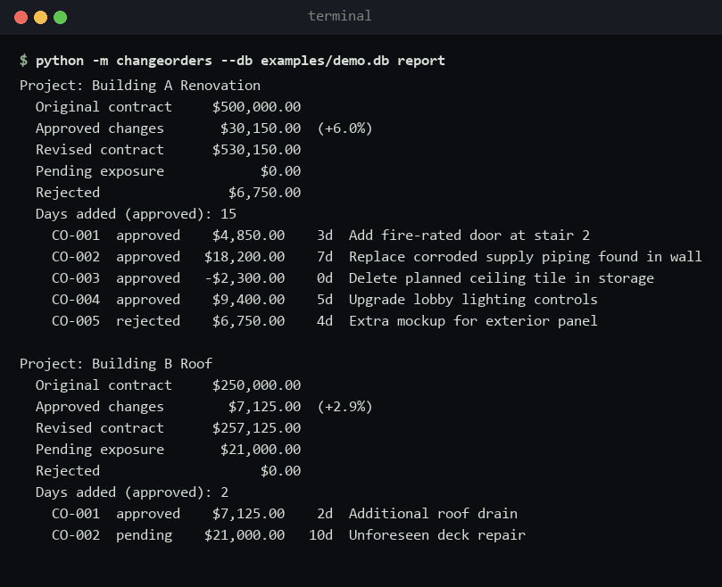

# change-order-log

[](https://github.com/yassine2med/change-order-log/actions/workflows/ci.yml)  

A SQLite log of construction change orders that keeps the running contract total, pending exposure and added days for each project.



## What it is for

A change order is a signed change to the price or schedule of a construction contract. On a renovation, dozens of them pile up, and the question "what is the contract worth now, and how much is still waiting for approval?" usually needs a spreadsheet and a calculator. A project manager, cost engineer or building owner's representative uses this log to record each change order once and read the revised contract value, the percent change and the pending exposure at any time.

## Install

```
git clone https://github.com/yassine2med/change-order-log
cd change-order-log
python -m pip install -r requirements.txt pytest
```

## How to use

| I want to | Command |
|---|---|
| Set the original contract for a project | `python -m changeorders --db demo.db contract "Building A Renovation" 500000 --days 180` |
| Add a change order (negative amount is a credit) | `python -m changeorders --db demo.db add PROJECT CO-006 "Title" 1500 --days 2 --submitted 2026-03-01` |
| Approve a change order | `python -m changeorders --db demo.db approve PROJECT CO-004` |
| Reject a change order | `python -m changeorders --db demo.db reject PROJECT CO-005` |
| Load change orders from a CSV | `python -m changeorders --db demo.db import examples/change_orders.csv` |
| Print totals and the list for all projects | `python -m changeorders --db demo.db report` |
| Print one project only | `python -m changeorders --db demo.db report --project "Building B Roof"` |

`add` also takes `--status pending|approved|rejected`. The CSV columns are project, number, title, amount, days_added, status, submitted. A project needs a contract before change orders can be added to it.

Example with the invented data:

```
python -m changeorders --db demo.db contract "Building A Renovation" 500000 --days 180
python -m changeorders --db demo.db contract "Building B Roof" 250000
python -m changeorders --db demo.db import examples/change_orders.csv
python -m changeorders --db demo.db approve "Building A Renovation" CO-004
python -m changeorders --db demo.db report
```

Output:

```
contract set: Building A Renovation $500,000.00
contract set: Building B Roof $250,000.00
imported 7 change orders
CO-004 approved
Project: Building A Renovation
  Original contract     $500,000.00
  Approved changes       $30,150.00  (+6.0%)
  Revised contract      $530,150.00
  Pending exposure            $0.00
  Rejected                $6,750.00
  Days added (approved): 15
    CO-001  approved    $4,850.00    3d  Add fire-rated door at stair 2
    CO-002  approved   $18,200.00    7d  Replace corroded supply piping found in wall
    CO-003  approved   -$2,300.00    0d  Delete planned ceiling tile in storage
    CO-004  approved    $9,400.00    5d  Upgrade lobby lighting controls
    CO-005  rejected    $6,750.00    4d  Extra mockup for exterior panel

Project: Building B Roof
  Original contract     $250,000.00
  Approved changes        $7,125.00  (+2.9%)
  Revised contract      $257,125.00
  Pending exposure       $21,000.00
  Rejected                    $0.00
  Days added (approved): 2
    CO-001  approved    $7,125.00    2d  Additional roof drain
    CO-002  pending    $21,000.00   10d  Unforeseen deck repair
```

`examples/demo.db` is this same database, prebuilt, so `python -m changeorders --db examples/demo.db report` prints the report without the setup steps.

## How it works

- Two tables: contracts (one row per project) and change_orders (keyed by project and number).
- Money is stored as integer cents to avoid rounding drift.
- Status is checked by the database: pending, approved or rejected.
- The report adds approved amounts to the original contract, sums pending and rejected separately, and adds the days of approved change orders.

## Limits

One contract amount per project, no line items, no attachments, no approval history. Days added are summed, not checked against the schedule.

MIT license. Yassine Emhamed, 2026.
